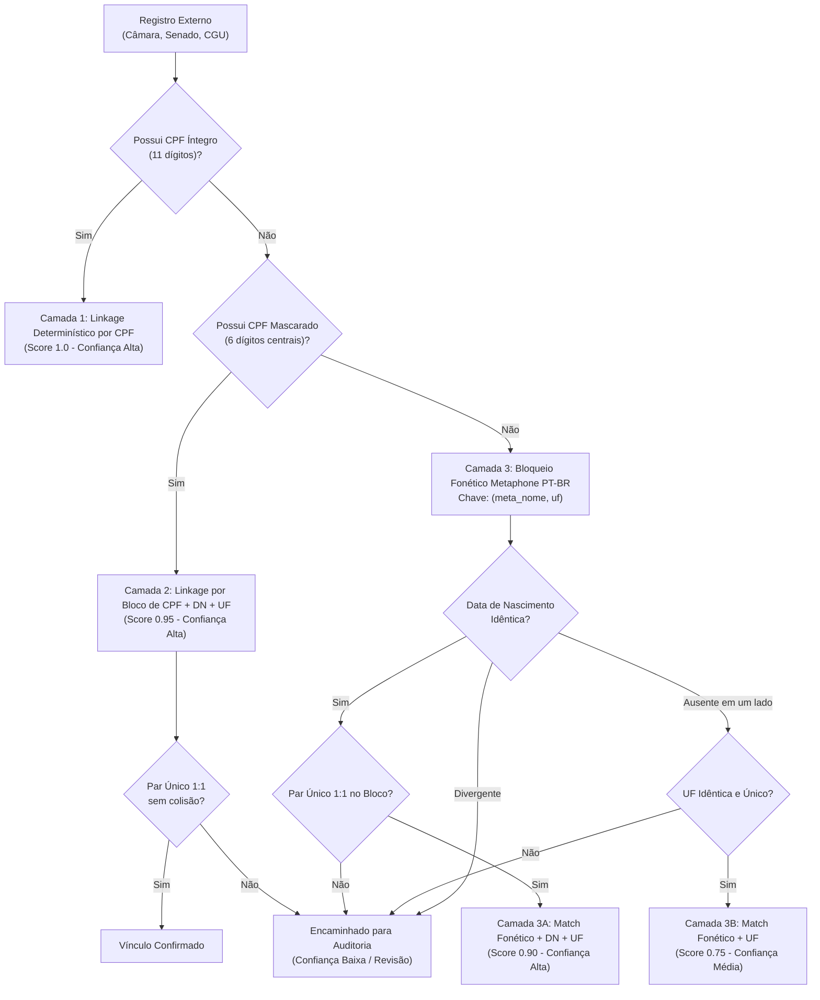

# RFC 001: Resolução de Entidades e Integração com a Base Eleitoral do TSE (`dim_politico`)

- **Status:** Proposta / Especificação Técnica (Spike R&D Concluído)
- **Data:** 2026-10-15
- **Autor:** Agente iPolitico / Time de Engenharia de Dados
- **Contexto:** Issue 06 do Roadmap CGU e Consolidação (`.scratch/roadmap-cgu-e-consolidacao/issues/06-spike-dim-politico-tse.md`) e `PRD.md`.
- **Camadas Alvo:** Silver (Ingestão de Dados Abertos do TSE) e Gold/Platinum (Dimensões Canônicas `dim_politico` e `dim_mandato`).

---

## 1. Contexto e Motivação do Negócio

O projeto **iPolitico** consolida o histórico completo de atuação parlamentar, remunerações e custos ao erário de políticos brasileiros. Atualmente, o pipeline já processa dezenas de domínios da Câmara dos Deputados (`id_deputado`), do Senado Federal (`codigo_parlamentar`) e do Poder Executivo Federal via Portal da Transparência/CGU (`cpf_mascarado` e `id_servidor`).

### 1.1 O Problema da Fragmentação de Identidades
No Brasil, cada poder e casa legislativa opera como um silo de dados:
1. **Câmara dos Deputados:** Identifica parlamentares pelo `id_deputado` (chave sequencial própria da Câmara). Expõe CPF íntegro (11 dígitos) no endpoint `/deputados/{id}`.
2. **Senado Federal:** Identifica parlamentares pelo `codigo_parlamentar` (ou `codSenador`). Não expõe CPF em suas rotas públicas de dados abertos.
3. **Poder Executivo (CGU/SIAPE/PEP):** Expõe servidores e agentes públicos com CPF mascarado nos primeiros e últimos dígitos (formato `***.123.456-**`).
4. **Tribunal Superior Eleitoral (TSE):** Cada candidatura em cada ciclo eleitoral recebe um novo identificador `SQ_CANDIDATO` (12 dígitos). Um mesmo político que concorreu a vereador, deputado e senador possui um `SQ_CANDIDATO` diferente para cada eleição disputada.

Sem um eixo central de unificação de identidades:
- O sistema não consegue relacionar que o deputado federal X é a mesma pessoa que foi senador no mandato anterior e prefeito de sua cidade natal anos antes.
- É impossível calcular a métrica cívica central do projeto: **"Qual foi o custo total acumulado deste político ao erário e como evoluiu seu patrimônio ao longo de toda a sua vida pública?"**.

### 1.2 Por que o TSE é a Âncora Canônica Natural?
O Tribunal Superior Eleitoral é a **única instituição brasileira** que registra compulsoriamente todo e qualquer cidadão que venha a exercer um mandato político eletivo no país (seja no Executivo ou no Legislativo, em âmbito municipal, estadual ou federal). A base eleitoral do TSE cobre:
- O histórico de todas as eleições ordinárias e suplementares desde a redemocratização (com dumps estruturados padronizados desde 1994).
- As declarações de bens patrimoniais detalhadas item a item (desde 2006).
- Os resultados oficiais de votação seção a seção e município a município.
- A prestação de contas de campanha (doadores e fornecedores contratados).

Portanto, os dados abertos do TSE constituem a **âncora definitiva** para a modelagem da dimensão mestra de pessoas físicas (`dim_politico`).

---

## 2. Análise Detalhada dos Dados Abertos do TSE

### 2.1 Canais de Acesso: Bulk (CDN) vs API REST (DivulgaCandContas)

| Dimensão de Comparação | Dumps em Bulk (Portal de Dados Abertos / CDN) | API REST DivulgaCandContas (`/divulga/rest/v1`) |
| :--- | :--- | :--- |
| **URL Base** | `https://cdn.tse.jus.br/estatistica/sead/odsele/...` | `https://divulgacandcontas.tse.jus.br/divulga/rest/v1/...` |
| **Protocolo & Formato** | HTTP GET, ZIP contendo CSVs (encoding Latin-1, `;`) | HTTP GET, JSON estruturado REST (Swagger v2) |
| **Disponibilidade** | Alta (servido por CDN de borda estática do TSE) | Média/Baixa em anos eleitorais (sujeito a rate limiting e 429) |
| **Modo de Extração** | Lote anual em alta velocidade (compatível com `BaseBulkExtractor`) | Pontual (candidato a candidato, necessita de milhões de chamadas) |
| **Bens Declarados** | Arquivo anual consolidado (`bem_candidato_{ANO}.zip`) | Embutido no DTO `buscar/{ano}/{sgUe}/{eleicao}/candidato/{id}` |
| **Votações** | Arquivo anual por município/zona ou seção eleitoral | Endpoints fragmentados por UE/cargo |
| **Decisão de Arquitetura** | **CANAL MANDATÓRIO PARA O PIPELINE ETL** | **Apenas para auditoria pontual e checagem ad-hoc** |

---

### 2.2 Estrutura dos Dumps Públicos do TSE

#### A. Candidaturas (`consulta_cand`)
- **URL Padrão:** `https://cdn.tse.jus.br/estatistica/sead/odsele/consulta_cand/consulta_cand_{ANO}.zip`
- **Série Temporal:** 1994 a 2026.
- **Granularidade:** Registro de candidatura individual por eleição (`ANO_ELEICAO`, `CD_ELEICAO`, `SQ_CANDIDATO`).
- **Campos Fundamentais:**
  - Identificação: `SQ_CANDIDATO` (chave por eleição), `NR_CANDIDATO`, `NM_CANDIDATO` (nome civil), `NM_URNA_CANDIDATO`.
  - Dados Pessoais: `NR_CPF_CANDIDATO`, `DT_NASCIMENTO`, `CD_GENERO`, `DS_GENERO`, `CD_GRAU_INSTRUCAO`, `CD_COR_RACA`, `CD_ESTADO_CIVIL`, `SG_UF_NASCIMENTO`, `NM_MUNICIPIO_NASCIMENTO`.
  - Disputa Eleitoral: `CD_CARGO`, `DS_CARGO`, `SG_UF`, `SG_UE`, `NM_UE`, `NR_PARTIDO`, `SG_PARTIDO`, `NM_COLIGACAO`.
  - Desfecho: `CD_SITUACAO_CANDIDATURA` (Apto/Inapto), `CD_DETALHE_SITUACAO_CAND` (Deferido/Indeferido/Renúncia), `CD_SIT_TOT_TURNO` (Eleito, Eleito por QP, Eleito por média, Suplente, Não eleito).

#### B. Bens Declarados (`bem_candidato`)
- **URL Padrão:** `https://cdn.tse.jus.br/estatistica/sead/odsele/bem_candidato/bem_candidato_{ANO}.zip`
- **Série Temporal:** 2006 a 2026 (não existem dados estruturados para 1998–2004 no CDN).
- **Granularidade:** Cada bem individual declarado na candidatura (`SQ_CANDIDATO`, `CD_ELEICAO`, `NR_ORDEM_BEM_CANDIDATO`).
- **Campos Fundamentais:**
  - `SQ_CANDIDATO`: FK para `consulta_cand` no mesmo ano.
  - `CD_TIPO_BEM_CANDIDATO`, `DS_TIPO_BEM_CANDIDATO`: Código e descrição do tipo de bem (apartamento, casa, ações, veículos, dinheiro em espécie). *Nota: em 2006 e 2008 100% dos registros foram codificados como 99 ("Outros bens")*.
  - `DS_BEM_CANDIDATO`: Texto livre com a especificação do bem.
  - `VR_BEM_CANDIDATO`: Valor em R$ informado pelo candidato (ex: `"150000,00"`).

#### C. Votação Nominal por Município e Zona (`votacao_candidato_munzona`)
- **URL Padrão:** `https://cdn.tse.jus.br/estatistica/sead/odsele/votacao_candidato_munzona/votacao_candidato_munzona_{ANO}.zip`
- **Série Temporal:** 1994 a 2026.
- **Granularidade:** Votação agregada do candidato por município e zona eleitoral.
- **Campos Fundamentais:** `ANO_ELEICAO`, `NR_TURNO`, `SG_UF`, `CD_MUNICIPIO`, `NM_MUNICIPIO`, `NR_ZONA`, `SQ_CANDIDATO`, `QT_VOTOS_NOMINAIS`.
- **Utilidade:** Permite identificar a base geográfica de sustentação do parlamentar, seu reduto eleitoral predominante e calcular o custo de campanha por voto conquistado.

#### D. Prestação de Contas Eleitorais (`prestacao_contas`)
- **URL Padrão:** `https://cdn.tse.jus.br/estatistica/sead/odsele/prestacao_contas/prestacao_de_contas_eleitorais_candidatos_{ANO}.zip`
- **Granularidade:** Receitas de campanha (doadores pessoas físicas e jurídicas) e despesas contratadas por fornecedor (CNPJ/CPF do favorecido).

---

### 2.3 Desafios Regulatórios e de Qualidade de Dados

#### 1. Mascaramento de CPF em 2024 (Resolução TSE nº 23.729/2024 / LGPD)
- **Cenário:** Nas eleições municipais de 2024, o TSE removeu o CPF dos dumps públicos, gravando a sentinela `-4` no campo `NR_CPF_CANDIDATO` e `"NÃO DIVULGÁVEL"` nos dados de endereço/documentos.
- **Mitigação no Pipeline:**
  - Políticos com carreira pregressa já possuem registro com CPF aberto nas eleições de 2006 a 2022.
  - Parlamentares federais em mandato possuem CPF íntegro e aberto na API da Câmara dos Deputados (`deputados_detalhe`).
  - Candidatos novatos de 2024 são vinculados através do motor probabilístico com **bloqueio estrito por Nome Fonético (Metaphone PT-BR) + Data de Nascimento + UF**, sem falso positivo.

#### 2. Variação Metodológica na Declaração de Bens
- Os valores são **auto-declarados** e não passam por conciliação bancária prévia pelo TSE antes da homologação da candidatura.
- Dívidas não são abatidas do total de bens (um imóvel de R$ 500 mil financiado com R$ 450 mil de saldo devedor entra com o valor integral declarado).
- A evolução patrimonial é uma grandeza calculada **entre eleições disputadas** pelo mesmo político.
- Recomenda-se disponibilizar no mart Gold o valor **nominal** e o valor **corrigido pelo IPCA acumulado** da data da eleição base até a eleição final.

---

## 3. Algoritmo de Entity Resolution (Record Linkage Multicamadas)

Para garantir execução vetorizada de alto desempenho em memória com Polars, o algoritmo de resolução de entidades opera em um **funil hierárquico determinístico-probabilístico**:

### 3.1 Normalização e Algoritmo Metaphone PT-BR Vetorizado
Para eliminar discrepâncias ortográficas frequentes em nomes brasileiros (Sousa/Souza, Luiz/Luís, Arthur/Artur, Célia/Sélia, Phelippe/Felipe):
1. **Sanitização de Agnomes e Preposições:** Remoção de agnomes (`FILHO`, `JUNIOR`, `NETO`, `SOBRINHO`) e partículas de ligação (`DE`, `DA`, `DO`, `E`) para focar no radical do prenome e patronímico.
2. **Substituições Fonéticas Canônicas:**
   - $Y \rightarrow I$, $W \rightarrow V$, $PH \rightarrow F$.
   - $CH, SH \rightarrow X$.
   - $C$ antes de $E, I \rightarrow S$; $C$ antes de $A, O, U \rightarrow K$.
   - $QU$ antes de $E, I \rightarrow K$; $QU$ antes de $A, O \rightarrow KU$.
   - $G$ antes de $E, I \rightarrow J$.
   - $H$ mudo eliminado.
   - $LH \rightarrow L$, $NH \rightarrow N$.
   - $Z$ e $S$ intervocálicos e finais harmonizados para $S$.
   - Consoantes geminadas duplicadas colapsadas ($RR \rightarrow R$, $SS \rightarrow S$, $LL \rightarrow L$).
3. **Execução Polars/Rust Regex:**
   A implementação em `src/ipolitico/core/metaphone_ptbr.py` foi desenhada sem utilizar lookaround (`(?=...)` ou `(?!...)`) nem backreferences (`\1`), executando nativamente na engine de regex do Rust de forma 100% vetorizada.

### 3.2 Níveis de Confiança e Isolamento de Ambiguidade
- **Alta (Score 0.90 a 1.0):** Match determinístico por CPF exato, bloco mascarado único ou fonética estrita com UF e data de nascimento idênticas. Gera alias automático no cluster.
- **Média (Score 0.70 a 0.89):** Match fonético único com UF idêntica onde a data de nascimento não está registrada em uma das pontas (ex: Senado antes de ingerir detalhe).
- **Baixa / Candidata a Revisão (Score < 0.70):** Homônimos com múltiplos candidatos no bloco fonético, datas de nascimento divergentes ou registros com mandatos simultâneos em esferas incompatíveis. **Não gera merge automático**; é registrado em `resolucoes_auditoria` com a justificativa de colisão.

---

## 4. Modelagem de Dados: Schemas Silver e Gold

### 4.1 Camada Silver (Dumps de Ingestão do TSE)

Foram implementados os schemas contratuais no dicionário `SILVER_SCHEMAS`:
- `tse_candidatos`: Histórico tabular de candidaturas com situação de deferimento e votação.
- `tse_bens`: Catálogo detalhado de bens declarados por candidato e eleição.
- `tse_votacao_munzona`: Votos nominais por município, zona e cargo.
- `tse_receitas_campanha`: Doações de campanha e fontes de financiamento eleitoral.
- `tse_despesas_campanha`: Fornecedores contratados e despesas de campanha.

---

### 4.2 Camada Gold: Modelo Dimensional Canônico (Star Schema)

A camada Gold materializa duas dimensões mestras e tabelas de relacionamento:

#### 1. `dim_politico` (Dimensão Mestra de Pessoas Físicas)
- Chave Primária: `politico_id` (Âncora Canônica Global: `pol_cpf_{cpf}` para quem tem CPF conhecido; `pol_tse_{sq_candidato}` ou `pol_camara_{id}` para legados sem CPF).
- Atributos Descritivos:
  - `nome_civil`: Nome de registro civil completo e normalizado.
  - `nome_politico_usual`: Nome parlamentar ou nome de urna mais representativo.
  - `cpf`: 11 dígitos numéricos (ou null).
  - `cpf_mascarado`: `***.123.456-**` para consultas que exijam exibição restrita.
  - `data_nascimento`: Data de nascimento padronizada ISO 8601.
  - `uf_origem`, `municipio_nascimento`: Naturalidade do indivíduo.
  - `genero`, `grau_instrucao`, `cor_raca`, `ocupacao_original`.
  - `primeiro_ano_eleicao`, `ultimo_ano_eleicao`.
  - `total_candidaturas`, `total_eleicoes_vencidas`.
  - `ultimo_partido`, `foto_url_oficial`.

#### 2. `dim_mandato` (Dimensão Temporal de Mandatos e Desempenho Eleitoral)
- Chave Primária: `mandato_id` (Composta por `{politico_id}_{ano_eleicao}_{cargo}_{uf}`).
- Chave Estrangeira: `politico_id` $\rightarrow$ `dim_politico.politico_id`.
- Atributos do Mandato:
  - `ano_eleicao`: Ano do ciclo eleitoral da disputa.
  - `tipo_cargo`: Padronizado (`PRESIDENTE`, `GOVERNADOR`, `SENADOR`, `DEPUTADO FEDERAL`, `DEPUTADO ESTADUAL`, `PREFEITO`, `VEREADOR`).
  - `esfera`: `FEDERAL`, `ESTADUAL` ou `MUNICIPAL`.
  - `uf`, `municipio`.
  - `partido_na_eleicao`, `coligacao`.
  - `resultado_eleicao`: `ELEITO_TITULAR`, `ELEITO_MEDIA`, `SUPLENTE`, `NAO_ELEITO`.
  - `total_votos_obtidos`.
  - `id_externo_camara`: ID do deputado na Câmara (se aplicável).
  - `codigo_externo_senado`: Código parlamentar no Senado (se aplicável).
  - `sq_candidato_tse`: Identificador da candidatura no TSE.
  - `bens_declarados_total`: Soma de bens declarados ao TSE para este mandato.

#### 3. `politicos_aliases` (Tabela de De-Para e Indexação Cruzada)
- Mapeia qualquer `id_natural` de qualquer fonte (`camara`, `senado`, `tse`, `cgu_servidores`, `cgu_pep`) para o `politico_id` canônico, registrando o método de resolução e o score de similaridade.

#### 4. `resolucoes_auditoria` (Trilha de Auditoria Cívica)
- Armazena todas as decisões tomadas pelo algoritmo de linking, incluindo os casos de baixa confiança e duplicidades homônimas isoladas para curadoria humana.

---

## 5. Plano de Implementação e Próximos Passos (Fatiamento)

Para integrar a base do TSE e consolidar a camada Gold, o trabalho será fatiado em etapas executáveis:

1. **Fatia 1: Extratores Bulk do TSE (`TseBulkExtractor`)**
   - Criação de `src/ipolitico/extractors/tse/bulk/base_tse_bulk.py`.
   - Download assíncrono com suporte a retomada (`Range header`) e semáforo global para o CDN do TSE.
   - Suporte aos arquivos anuais de `consulta_cand` (1994–2026) e `bem_candidato` (2006–2026).
2. **Fatia 2: Transformers Silver do TSE**
   - Normalização de tipos (conversão de `VR_BEM_CANDIDATO` com vírgula para `Float64`, remoção de sentinelas `-4`, `-1`, `-3`).
   - Escrita append-only em micro-batches Parquet na camada Silver.
3. **Fatia 3: Pipeline de Consolidação Gold (`EntidadeCanonicaBuilder`)**
   - Integração do motor `record_linkage.py` no builder da camada Gold.
   - Re-ancoragem dos clusters para o padrão canônico baseado no TSE/CPF.
   - Deduplicação via DuckDB (`DataLakeOptimizer`) para geração dos arquivos `dim_politico.parquet` e `dim_mandato.parquet`.
4. **Fatia 4: Camada Platinum / Data Marts de Evolução Patrimonial**
   - Criação da tabela de fatos agregada `fct_evolucao_patrimonial` cruzando bens declarados por político eleição a eleição, comparando custos totais de campanha e remunerações no Congresso Nacional.

---

## 6. Conformidade com Diretrizes de Engenharia e Governança

- **TDD:** Módulos de fonética (`metaphone_ptbr.py`) e de record linkage (`record_linkage.py`) implementados e cobertos com testes unitários em `tests/core/test_metaphone_ptbr.py` e `tests/gold/test_record_linkage.py`.
- **Performance Vetorizada:** Sem laços `for` em DataFrames; uso exclusivo de expressões Polars (`pl.col()`, `pl.when()`, joins vetorizados).
- **Imutabilidade:** Camada Silver append-only; deduplicação analítica na Gold.
- **Tipagem e Contratos:** Contratos registrados em `constants.py` e `schemas.py`.
