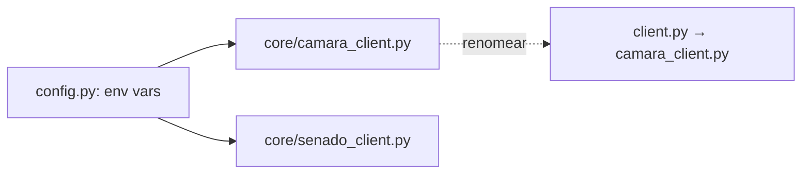

# Implementação da API do Senado no iPolitico ETL

> **Plano consolidado após sessão de design (2026-06-27)**
> **Branch:** `feat/senado-api` (a partir de `feat/integration-test-and-examples`)

---

## Decisões de Design

| # | Decisão | Escolha |
|---|---|---|
| 1 | Branch | `feat/senado-api` a partir de `feat/integration-test-and-examples` |
| 2 | Estrutura de diretórios | `extractors/senado/api/`, `transformers/senado/` (um .py por tag) |
| 3 | Cliente HTTP | `SenadoClient` separado em `core/senado_client.py`, sem refatorar CamaraClient |
| 4 | Renomeação | `core/client.py` → `core/camara_client.py` (só arquivo, classe intacta) |
| 5 | Config de ambiente | Tudo no `config.py` existente |
| 6 | Semáforo independente | `SENADO_HTTP_CONCURRENCY=5` no `SenadoClient`, rodando em paralelo com Câmara via `asyncio.gather` |
| 7 | Roteamento fonte | Flag `--source {camara, senado, all}` + YAML separado (`configs/senado_pipeline.yaml`) |
| 8 | Prioridade de domínios | Exclusivos primeiro: emendas > vetos > notas taquigráficas > discursos > equivalentes |
| 9 | Endpoints deprecated | Ignorar todos (42/157). Focar nos 115 ativos. Nenhuma perda de dados. |
| 10 | Paginação | Senado não usa — retorna arrays planos. `SenadoBaseExtractor.fetch_flat()` com janelas temporais no planejador |
| 11 | Granularidade de jobs | Listas: 1 request. Temporais: janela de 1 mês. Orçamento: 1 ano. |
| 12 | Formato XML-heritage | `SenadoBaseExtractor.flatten_response(data, data_path)` + normalização de objeto-vs-array |
| 13 | DomainType | Unificado no enum existente `DomainType`. Roteamento via YAML+`--source`. |
| 14 | Ordem de pipeline | Tupla `FULL_PIPELINE` combinada (Câmara + Senado) em `domain_order.py` |
| 15 | PipelineManager | Reutilizado e tornado genérico. Metadata service injetado por fonte. |

---

## Plano de Implementação

### Pré-requisito: preparar infraestrutura compartilhada

> Arquivos tocados: `core/client.py` → `core/camara_client.py`, `core/config.py`, `core/senado_client.py`



- Renomear `core/client.py` → `core/camara_client.py` (e atualizar 13 imports)
- Adicionar `SENADO_API_BASE_URL` e `SENADO_HTTP_CONCURRENCY=5` no `config.py`
- Criar `core/senado_client.py` com `SenadoClient` (semáforo 5, URL base `/`, rate limit de 10 req/s)
- Adicionar suporte a `Accept` header flexível (o Senado aceita `.json`, `.xml`, `.csv`)
- **Teste:** `pytest tests/core/test_senado_client.py`

---

### Fase 1 — Base do Senado (infraestrutura do provider)

> Arquivos novos: `extractors/senado/api/senado_base.py`, `configs/senado_pipeline.yaml`
> Arquivos tocados: `pipeline/federation.py`, `pipeline/manager.py`, `pipeline/domain_order.py`, `core/constants.py`, `core/domain_spec.py`, `main.py`, `pipeline/builder.py`

1. **Criar `SenadoBaseExtractor`** em `extractors/senado/api/senado_base.py`
   - Herda de `BaseExtractor`
   - `fetch_flat(endpoint, params)` — chama `SenadoClient.fetch()`, retorna array
   - `flatten_response(data, data_path)` — extrai array do envelope XML-heritage
   - `_ensure_list(item)` — normaliza objeto-único para lista
   - Sem paginação — retorna tudo de uma vez

2. **Criar `SenadoMetadataService`** em `services/senado_metadata.py`
   - `get_current_senado_legislature()` — busca no Senado (análogo ao da Câmara)
   - Ou versão simplificada: retorna a legislatura atual com base no ano

3. **Tornar `PipelineManager` genérico**:
   - `CamaraJobPlanner` → `JobPlanner` (renomear classe/arquivo)
   - Remover fallback hardcoded `CamaraMetadataService` da injeção
   - `warmup_for_domain` já é opcional via `hasattr`

4. **Criar `SenadoSourceProvider`** em `sources/senado_provider.py`
   - Mesmo pattern de `CamaraSourceProvider`
   - Carrega `senado_pipeline.yaml`
   - Instancia `SenadoClient` + `PipelineBuilder` + `PipelineManager` + `SenadoMetadataService`

5. **Criar `configs/senado_pipeline.yaml`** vazio (cresce conforme implementamos domínios)

6. **Adicionar `--source` na CLI** (`main.py`)
   ```python
   parser.add_argument("--source", type=str, choices=["camara", "senado", "all"], default="all")
   ```
   - `source=all` instancia ambos os providers e chama `asyncio.gather`
   - Cada provider só processa domínios do seu YAML

7. **Tornar `FederationOrchestrator` agnóstico** (`federation.py`)
   - Aceita lista de `SourceProvider` genérica (não só `CamaraSourceProvider`)
   - `asyncio.gather` em paralelo

8. **Adicionar novos `DomainType`** em `constants.py` e `domain_spec.py`
   - `SENADORES`, `SENADORES_DETALHE`, `PROCESSOS`, etc.
   - Expandir `FULL_CAMARA_PIPELINE` → `FULL_PIPELINE` em `domain_order.py`

9. **Teste smoke:** `python -m ipolitico pipeline --source senado --list-domains` mostra árvore

---

### Fase 2 — P0: Senadores + Processos + Votações (base)

```
extractors/senado/api/
├── senado_base.py       ← já criado
├── senadores.py         ← GET /senador/lista/atual, /senador/{codigo}
├── processos.py         ← GET /processo, /processo/{id}
├── votacoes.py          ← GET /votacao, /votacaoComissao/...

transformers/senado/
├── senadores_transformer.py
├── processos_transformer.py
├── votacoes_transformer.py
├── institucional_transformer.py   ← dados rasos (comissões, blocos, etc.)
```

#### 2.1 — Senadores (2 endpoints)

| Endpoint | DomainType | Job | Data path |
|---|---|---|---|
| `GET /senador/lista/atual` | `SENADORES` | 1 request | `["Parlamentares", "Parlamentar"]` |
| `GET /senador/{codigo}` | `SENADORES_DETALHE` | 1 request por senador | top-level dict |

- Extractor: busca lista, pra cada senador faz detalhe
- Transformer: normalize PascalCase → snake_case, schema Silver
- Dependente de nada (root)

#### 2.2 — Processos (2+ endpoints)

| Endpoint | DomainType | Jobs | Data path |
|---|---|---|---|
| `GET /processo` | `PROCESSOS` | 1 mês por job | top-level array |
| `GET /processo/{id}` | `PROCESSOS_DETALHE` | 1 por processo | top-level dict |
| `GET /processo/emenda` | `PROCESSOS_EMENDAS` | 1 mês por job | top-level array |
| `GET /processo/documento` | `PROCESSOS_DOCUMENTOS` | 1 mês por job | top-level array |
| `GET /processo/relatoria` | `PROCESSOS_RELATORIAS` | 1 mês por job | top-level array |

- Extractor: planejador cria janelas mensais (`dataInicioApresentacao`, `dataFimApresentacao`)
- Transformer: extrai campos relevantes, aplica schema Silver

#### 2.3 — Votações (2+ endpoints)

| Endpoint | DomainType | Jobs | Data path |
|---|---|---|---|
| `GET /votacao` | `VOTACOES_SENADO` | 1 mês por job | top-level array |
| `GET /votacaoComissao/comissao/{sigla}` | `VOTACOES_COMISSAO` | 1 mês por comissão | A verificar |

- Extractor: filtro por `dataInicio` e `dataFim`
- Dependente de `PROCESSOS` (para saber quais processos foram votados)

#### 🧪 Teste Fase 2
```bash
python -m ipolitico pipeline --source senado --full-load --domains senadores
python -m ipolitico pipeline --source senado --incremental
python -m ipolitico --audit-coverage  # deve mostrar senadores, processos, votacoes_senado
```

---

### Fase 3 — P0: Exclusivos Senado (alto valor)

#### 3.1 — Emendas Orçamentárias (2 endpoints)

| Endpoint | DomainType | Jobs |
|---|---|---|
| `GET /orcamento/lista` | `ORCAMENTO_EMENDAS` | 1 por ano |
| `GET /orcamento/oficios` | `ORCAMENTO_OFICIOS` | 1 por ano |

- Dados que a Câmara **não** oferece
- Job planejador: 1 request por ano

#### 3.2 — Vetos Presidenciais (3 endpoints)

| Endpoint | DomainType | Jobs |
|---|---|---|
| `GET /materia/vetos/{ano}` | `VETOS_PRESIDENCIAIS` | 1 por ano |
| `GET /plenario/resultado/veto/{codigo}` | `VETOS_DETALHE` | 1 por veto |

- Endpoints novos (não deprecated, apesar de estarem em `/materia/` — confirmar)
- Job planejador: 1 request por ano

#### 3.3 — Notas Taquigráficas (2 endpoints)

| Endpoint | DomainType | Jobs |
|---|---|---|
| `GET /taquigrafia/notas/sessao/{idSessao}` | `NOTAS_TAQUIGRAFIA` | Por sessão (depende de plenário) |
| `GET /taquigrafia/notas/reuniao/{idReuniao}` | `NOTAS_COMISSAO` | Por reunião (depende de comissão) |

- Texto integral de discursos — dado riquíssimo para análise
- Dependente de plenário / comissão (precisa do ID da sessão/reunião)

---

### Fase 4 — P1: Discursos + Comissões + Plenário

#### 4.1 — Discursos (4 endpoints)

| Endpoint | DomainType | Jobs |
|---|---|---|
| `GET /senador/{codigo}/discursos` | `SENADORES_DISCURSOS` | 1 mês por senador |
| `GET /plenario/lista/discursos/{inicio}/{fim}` | `DISCURSOS_PLENARIO` | 1 mês |
| `GET /discurso/texto-integral/{codigo}` | `DISCURSOS_TEXTO` | 1 por discurso |

#### 4.2 — Comissões (5+ endpoints)

| Endpoint | DomainType |
|---|---|
| `GET /comissao/lista/{tipo}` | `COMISSOES_SENADO` |
| `GET /comissao/{codigo}` | `COMISSOES_DETALHE` |
| `GET /comissao/agenda/{inicio}/{fim}` | `COMISSOES_REUNIOES` |

#### 4.3 — Plenário (4+ endpoints)

| Endpoint | DomainType |
|---|---|
| `GET /plenario/agenda/dia/{data}` | `PLENARIO_AGENDA` |
| `GET /plenario/resultado/{data}` | `PLENARIO_RESULTADOS` |

#### 4.4 — Composição (4 endpoints)

| Endpoint | DomainType |
|---|---|
| `GET /composicao/lista/blocos` | `BLOCOS_SENADO` |
| `GET /composicao/lideranca` | `LIDERANCAS_SENADO` |
| `GET /composicao/mesaSF` | `MESA_SENADO` |
| `GET /composicao/mesaCN` | `MESA_CONGRESSO` |

---

### Fase 5 — Gold Unificada (não-ETL, opcional)

> **Nota:** Como decidido, a conexão cross-casa (ex: senador que foi deputado) **não é responsabilidade do ETL**. Fica para a camada analítica.

Se desejado, scripts em `scripts/`:

| Script | O que faz |
|---|---|
| `scripts/senado_gold_consolidate.py` | Compacta + dedup Silver → Gold para domínios do Senado |
| `scripts/federated_views.py` | (Opcional) Cria views no DuckDB unificando Câmara + Senado via CPF |

---

## Timeline Estimada

| Fase | Esforço | Riscos |
|---|---|---|
| **Pré-req:** Renomear `client.py` + configs + `SenadoClient` | 2h | Baixo — mudança mecânica |
| **Fase 1:** Base provider, YAML, `--source`, `DomainType` | 1 dia | Médio — toca `main.py`, `federation.py` |
| **Fase 2:** Senadores + Processos + Votações | 5-7 dias | Médio — XML-heritage no transformer |
| **Fase 3:** Emendas + Vetos + Notas Taquigráficas | 3-4 dias | Médio — endpoints exclusivos podem ter schema imprevisível |
| **Fase 4:** Discursos + Comissões + Plenário + Composição | 5-7 dias | Baixo — já conhecemos o padrão |
| **Testes + Smoke** | 2 dias | Médio — sem testes de integração, regressão é silenciosa |
| **Total** | **~20-25 dias** | |

---

## Arquivos Alterados/Criados (resumo)

```
# Renomeado
core/client.py → core/camara_client.py

# Criados
core/senado_client.py
extractors/senado/api/senado_base.py
extractors/senado/api/senadores.py
extractors/senado/api/processos.py
extractors/senado/api/votacoes.py
extractors/senado/api/orcamento.py
extractors/senado/api/vetos.py
extractors/senado/api/discursos.py
extractors/senado/api/comissoes.py
extractors/senado/api/plenario.py
extractors/senado/api/composicao.py
transformers/senado/senadores_transformer.py
transformers/senado/processos_transformer.py
transformers/senado/votacoes_transformer.py
transformers/senado/institucional_transformer.py
services/senado_metadata.py
sources/senado_provider.py
configs/senado_pipeline.yaml
tests/extractors/senado/... (mirror dos de Câmara)

# Alterados
core/config.py (novas env vars)
core/constants.py (DomainTypes, EarliestDates, DOMAIN_LABELS)
core/domain_spec.py (DOMAIN_SPECS)
pipeline/domain_order.py (FULL_PIPELINE)
pipeline/manager.py (tornar genérico)
pipeline/federation.py (SourceProvider genérico)
pipeline/builder.py (aceitar client genérico)
main.py (--source flag, providers condicionais)
```
